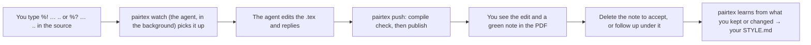

# PairTeX

**Pair-write your LaTeX paper with an AI coauthor, in Overleaf or your own editor.**

Write a LaTeX paper with a coding agent as a live coauthor, without leaving your editor. You type a comment into the source,
`%! make this tighter..`; about a minute later the agent has edited the text (or, for a question, only answered), put its reply in
a green note next to your comment, and published both back to the same paper. No copying text into a chat and back.

Along the way it keeps a guide to your writing style, learned from the edits you keep, the ones you rewrite and the ones you undo,
so its first drafts need fewer comments over time.

It works with a paper in **Overleaf** (through Overleaf's git integration), in **any git remote** (GitHub, GitLab), or in a
**local folder** you edit with VS Code, TeXstudio, Emacs or any other editor. The agent is Claude Code by default; any agent
that runs shell commands can drive it ([AGENTS.md](AGENTS.md)).



## Install

Needs Python 3.9+, git, and for the compile check latexmk (TeX Live or MacTeX). macOS and Linux; on Windows, use WSL.

```sh
git clone <this repository> pairtex && cd pairtex
./install.sh                        # links the Claude Code skill and ~/.local/bin/pairtex
pairtex setup --name "Ada Lovelace"      # your name exactly as Overleaf (or your git commits) shows it to coauthors
```

`pairtex setup` creates your **data home**, `~/.pairtex` (`--home DIR` to put it elsewhere): your profile, your style vault
and your papers' working copies. It never goes into this repository. The name matters: on a shared paper, the loop answers only
comments written under it.

## Add a paper

Pick where the paper lives:

```sh
pairtex init mypaper --overleaf 6a1b2c3d4e5f... --main main.tex     # an Overleaf project (id from its URL)
pairtex init mypaper --git git@github.com:me/paper.git --main main.tex
pairtex init mypaper --folder ~/papers/mypaper --main main.tex       # a folder your editor saves into
```

Optional: `--protect ada grace` (coauthors' note macros the agent must never remove), `--title "…"`, `--compiler xelatex` (otherwise
taken from a `% !TEX program = …` line or a `latexmkrc`, else pdfLaTeX). Then add the paper's rules to
`~/.pairtex/projects/mypaper/NOTES.md`: its terms, where its facts come from, what must not change.

- **Overleaf.** Git integration is a premium Overleaf feature; every member of a project whose owner has a premium plan can use
  it. git asks for a username and a password the first time: the username is `git` and the password is a git authentication
  token from your Overleaf account settings. Let your credential helper remember it (the macOS keychain, Git Credential Manager,
  or libsecret on Linux); `pairtex` never stores it.
- **Git remote.** Your own commits are your edits. Commit and push to send a comment.
- **Folder.** Save the file to send a comment. The agent writes its edit back into the folder, but only into a file you have not
  saved again since; otherwise it merges with your newer version first. Let your editor reload files changed on disk: VS Code does
  this for files without unsaved changes (turn on `files.autoSave`); in Emacs use `global-auto-revert-mode`; in Vim `:set
  autoread`. Every version, yours and the agent's, is kept in `~/.pairtex/projects/mypaper/folder.git`.

## Start the loop

In Claude Code, in any folder: "watch mypaper" (or 监听 mypaper). That session becomes the paper's coauthor: it reads your style
guide, starts the watcher in the background and tells you it is listening. One session per paper; to move the loop, ask another
session to take it over.

## Comment

Two markers, one character each, after LaTeX's `%` (so nothing reaches the PDF), and `..` to send:

| Type | To | The agent |
| --- | --- | --- |
| `%! … ..` | ask for a change | edits the text, replies in a green note next to it, publishes |
| `%? … ..` | ask a question ("why was this written so in the last version?", "what does this sentence do for the paper?") | answers in a green note and changes no text |

```latex
Iterative preference optimization trains ... (a paragraph)
%! too many jargons here; explain reference refresh before using it,
% and keep it under five lines..

The policy converges whenever the gain is small. %? is this proved, or only observed?..

We study the loop. [[One round of training is one mirror step.]] The target is the tilted reference.
%? why does this sentence come before the target?..
```

- **Where it points.** A comment line under a paragraph is about that paragraph; at the end of a line, about that line.
- **Part of a paragraph.** Put `[[` and `]]` around the words you mean, even across lines. The brackets show in the PDF while the
  comment waits and the agent removes them when it answers. `【` `】` work too.
- **Mid-sentence.** `%!` in the middle of a line marks that point; LaTeX hides the rest of that line until the agent answers, and
  the agent puts the hidden words back.
- **`..` sends it.** Take as long as you like; a comment can run over several `%!` or `%` lines. Three dots are an ellipsis and do
  not end it (`such as PPO, ..., SFT` is safe).
- Write it the way you would to a coauthor: "this sentence", "this section", "everywhere" all work. For a change, the agent applies
  it to every parallel place (abstract, introduction, conclusion) and says where.
- Anything a coauthor could do from a comment works: "draft this section from the bullets above", "read this as a reviewer: what
  is missing?", "turn my Chinese note into a paragraph".

## See the answer

A minute or so later your comment has become one line, a green note in the PDF where you commented:

```latex
Iterative preference optimization trains ... (the revised paragraph)
\claude{c7}{too many jargons here; explain reference refresh before using it, and keep it under five lines}{Defined
reference refresh at first use (also in the abstract); cut the recipe list to one clause. 4 lines.}
```

It reads, in green: "[c7] **Ada:** too many jargons here; … **Claude:** Defined reference refresh at first use …". The first
note adds the `\claude` macro to the preamble. Where a note would break the build (an equation, a table, a caption, a footnote,
the preamble), the thread stays in `%` lines instead (`%!c8 …` and `%!c8> …`). Text your engine cannot print (Chinese under
pdfLaTeX) stays word for word in a `%` line above its note; under XeLaTeX or LuaLaTeX with ctex or xeCJK it goes in the note.

| You want to | Do this |
| --- | --- |
| Accept | Delete the note's line. Edit the new text first if you like: your edits teach the style guide |
| Follow up or push back | Write `%! … ..` or `%? … ..` directly under the note. The agent sees the whole thread |
| Turn an answer into a change | `%! do it..` under the question's note |
| Undo | `%! revert this..` under the note |
| Choose between options the agent offered | `%! 2..` under the note |
| Hide every note in the PDF | Delete the first `%` of the `% \def\hideclaudenotes{}` line in the preamble |

## Coauthors

Several people can run their own loop on one paper. Each loop answers only its owner's comments (Overleaf records who typed
what), numbers them with its owner's prefix (`ada7`, `grace3`), and learns only from its owner's edits, into its owner's style vault.
A comment by a coauthor who runs no loop is left alone; to answer it from your loop, add them to the paper's `project.json`:

```json
"comments_from": {"Grace Hopper": "Grace"}
```

Their notes then say "[c9] **Grace:** …". Do not list someone who runs their own loop on the same paper; `pairtex status` warns if you do.

## Your writing style guide

`~/.pairtex/vault/STYLE.md` is read before every edit and grows after every batch. The evidence behind it is in
`vault/evidence.jsonl`, one event per line:

- **You rewrote the agent's text** (before or after accepting): the word-level diff from its version to yours. The strongest
  signal.
- **You undid an edit**: recorded under "What … undid", so it is not repeated.
- **Your comments**: preferences you state ("too dry", "以后不要…") become rules in your words; "always", "never" and "以后" make
  them confirmed at once.
- **Your own writing** in the editor: style patterns in what you write and cut yourself (content changes are ignored).
- **Edits you kept as written**: confirm the rules the agent applied.

A pattern starts as tentative and becomes confirmed after three independent pieces of evidence, or when you say it is general.
Paper-specific points (terms, notation) go to that paper's `NOTES.md` instead. Edit STYLE.md yourself whenever you disagree: your
edits win. The data home is a git repository, so every change to the guide is a commit you can read or undo.

## Before submission

```sh
pairtex check mypaper                         # notes, comments, threads, [[ ]], the note macro and coauthor notes still in the paper
pairtex clean mypaper --out ~/submit --compile   # a copy without them, and without % comments (arXiv publishes your source)
```

`--keep-comments` keeps your ordinary `%` comments. Coauthor notes stay in the clean copy; `pairtex clean` says so.

## What goes where

- `pairtex` itself talks only to the paper's git remote (or reads your folder). It sends nothing anywhere else.
- The agent reads the comment, the paragraph around it, your style guide and the paper's notes, and sends them to its model
  provider, as any coding agent does with the files it works on.
- Your profile, style vault and working copies stay in your data home. Notes are visible to anyone who reads the PDF; set
  `"notes": "source"` in a paper's `project.json` to keep threads in `%` lines instead.

## Commands

The agent runs these; they are here for reference.

| Command | What it does |
| --- | --- |
| `pairtex setup --name …` | Your profile and data home (name, the handle notes print, comment-id prefix, agent name) |
| `pairtex init SLUG --overleaf ID \| --git URL \| --folder DIR` | Registers a paper and makes the loop's own working copy |
| `pairtex status SLUG` | Head, checkout, watcher, comments by state, comments left to coauthors, evidence waiting |
| `pairtex watch SLUG` | Polls the paper (every 8 s, slower when idle), takes the comments that end with `..`, prints the batch and exits |
| `pairtex resolve SLUG c7 "reply"` | Turns comment c7 into a green note with the reply (`--plain`: `%` lines) and records which edits answered it |
| `pairtex push SLUG -m "…"` | Compile check (only new LaTeX errors block), guards, commit, merge with your newer typing, publish |
| `pairtex learn SLUG [--ack E0012 …]` | Shows style evidence in full, or marks it learned |
| `pairtex show SLUG [c7] [--all] [--diff]` | Comments in progress, or the whole history |
| `pairtex check SLUG` / `pairtex clean SLUG --out DIR` | Before submission: what is left; a clean copy |
| `pairtex paths` | Where the code, profile, vault and papers are |
| `pairtex migrate` | Moves data out of the code folder (installs from before 0.4) |

**Safety built in.** `push` refuses to publish new files, to remove a protected coauthor note, to delete a thread, or to introduce
a LaTeX error the paper did not have. If you edit the same lines while the agent works, nothing is published: its diff is saved
under `projects/<slug>/conflicts/` and redone on your new text. Edits on neighbouring lines merge automatically. Every change is
an ordinary commit (`pairtex: c7: …`) in the paper's history, so any edit can be reverted.

**Limits.** Overleaf's own review comments (the comment bubbles) are not in its git history, so the loop cannot see them: use
`%!` and `%?`. The compile check runs locally with your TeX installation, which can differ slightly from Overleaf's. Who wrote a
comment or an edit is read from the name on each Overleaf commit; if Overleaf ever records two people's simultaneous edits in one
commit, the loop takes them as the edits of the person that commit names.

## Files

| Path | Purpose |
| --- | --- |
| `bin/pairtex` | The command-line tool (Python 3.9+, standard library, git, latexmk); `bin/ow` is its old name |
| `skill/` | The Claude Code skill, linked at `~/.claude/skills/pairtex` by `install.sh` |
| `AGENTS.md` | Running the loop with another agent |
| `templates/` | Starting points for a new style guide, loop preferences and paper notes |
| `tests/test_e2e.py` | End-to-end test against local stand-ins for Overleaf, a git remote and a folder: `python3 tests/test_e2e.py` |
| `ROADMAP.md`, `CHANGELOG.md` | What comes next, what changed |
| `LICENSE` | MIT |
| `~/.pairtex/` | Your data: `profile.json`, `vault/` (STYLE.md, evidence.jsonl, preferences.md), `projects/<slug>/` |

## License

MIT ([LICENSE](LICENSE)). PairTeX is an independent project, not affiliated with Overleaf.
