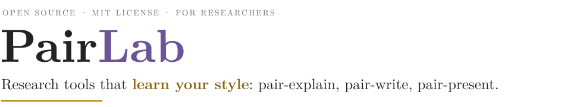
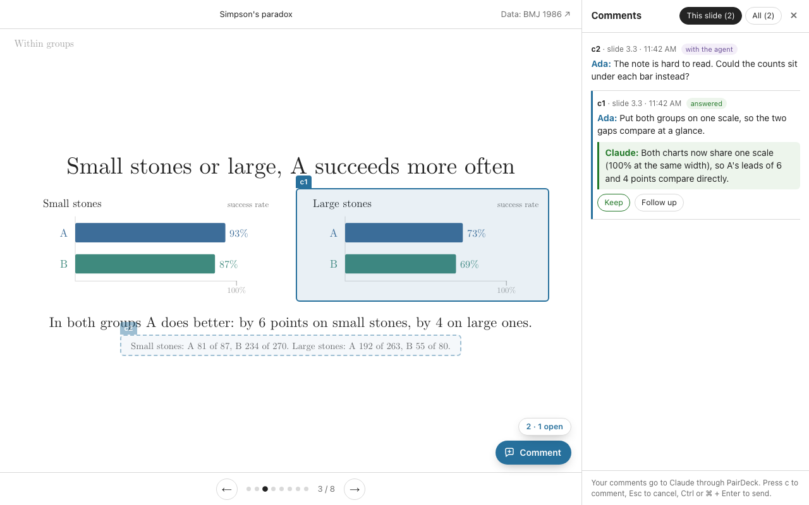
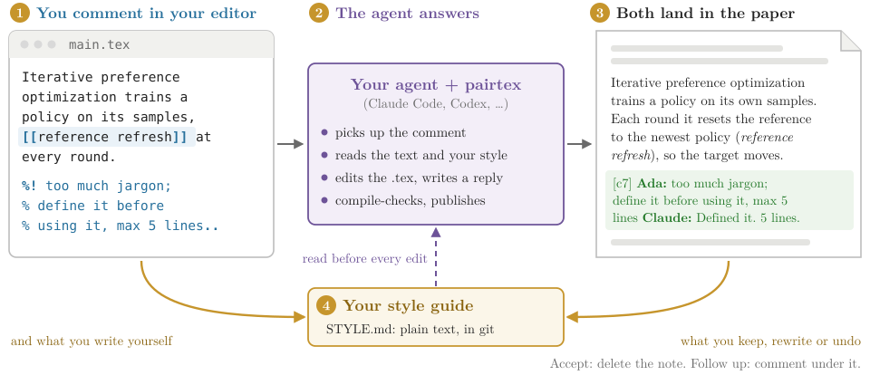
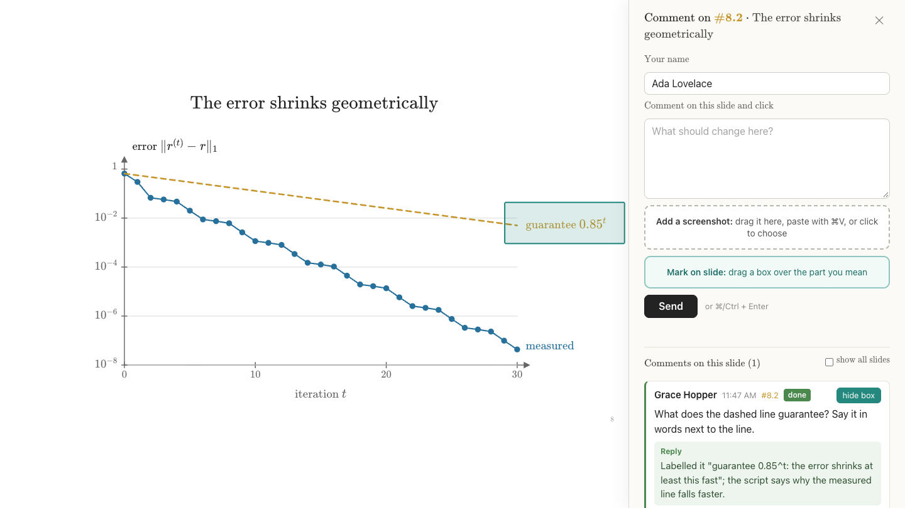

<p align="center">
  <picture>
    <source media="(prefers-color-scheme: dark)" srcset="docs/figures/banner-dark.svg">
    
  </picture>
</p>

<p align="center">
  <a href="LICENSE"></a>
  
  
  
</p>

<!-- TABBAR -->
<p align="center"><a href="README.md"><picture><source media="(prefers-color-scheme: dark)" srcset="docs/figures/tab-overview-on-dark.svg"></picture></a><a href="pairdeck/README.md"><picture><source media="(prefers-color-scheme: dark)" srcset="docs/figures/tab-pairdeck-off-dark.svg"></picture></a><a href="pairtex/README.md"><picture><source media="(prefers-color-scheme: dark)" srcset="docs/figures/tab-pairtex-off-dark.svg"></picture></a><a href="pairtalk/README.md"><picture><source media="(prefers-color-scheme: dark)" srcset="docs/figures/tab-pairtalk-off-dark.svg"></picture></a></p>
<!-- /TABBAR -->

Research has three moments when you make something for other people: after a brainstorm you report what you found, then you
write the paper, then you give the talk. PairLab gives each moment an AI coauthor that works **where that thing lives**, in
the background, and keeps **a style guide of you** that gets closer with every round. You give feedback the way you would to a
colleague; the fix, and a short reply, land in the deck, the paper or the talk.

<p align="center">
  <picture>
    <source media="(prefers-color-scheme: dark)" srcset="docs/figures/workflow-dark.svg">
    
  </picture>
</p>

## What the three tools share

<p align="center">
  <picture>
    <source media="(prefers-color-scheme: dark)" srcset="docs/figures/promises-dark.svg">
    
  </picture>
</p>

1. **It learns you.** A chat window forgets your corrections. Each tool keeps a style guide, `STYLE.md`, with the evidence
   behind every rule: your academic voice for papers, your visual taste for decks, your pacing and phrasing for talks. A
   pattern becomes a rule after three independent pieces of evidence, or at once when you say "always" or "never".
2. **You stay in flow.** No copying text into a chat and back. You comment in the LaTeX source, on the slide, or in the
   script; a watcher wakes your agent, which fixes the work, answers next to your comment, publishes, and goes back to
   waiting.
3. **It starts from your own work and runs on your own plan.** `seed` reads papers, decks and talks you already made, so the
   first draft is already close; your feedback refines it from there. The thinking happens in the coding agent you already
   pay for: Claude Code or Codex. There is no PairLab server, model or API key.

The three tools follow one contract for this memory: [docs/style-vault.md](docs/style-vault.md).

## The tools

### PairDeck: report what you found

You give your agent the material (a paper, a project, the results of an investigation) and it builds a short web deck that
explains one idea with pictures that build up step by step, checked slide by slide on screenshots. Then you drag a box over
any slide in the local review page and type what should change: the agent fixes the deck in the background and replies under
your comment. Your decks look like yours from the first one, because the style guide is seeded from decks you already made.

<p align="center"></p>

**[Read the PairDeck page →](pairdeck/README.md)**

### PairTeX: write the paper

You type a comment into the LaTeX source, right where the text is (`%! make this tighter..`). About a minute later the agent
has edited the text, put its reply in a green note next to your comment, and published both back to the same paper:
Overleaf, any git remote, or a folder your editor saves into. Coauthors keep their own loops and their own style guides.

<p align="center">
  <picture>
    <source media="(prefers-color-scheme: dark)" srcset="pairtex/docs/figures/loop-dark.svg">
    
  </picture>
</p>

**[Read the PairTeX page →](pairtex/README.md)**

### PairTalk: give the talk

Your talk runs in the browser, one file per slide, with builds click by click and a speaker script, one note per click.
You, or a coauthor through your own passcode-protected site, press `c` on any slide and click, draw a box around the part
you mean, and write. Your agent fixes the slide and the script, checks every click with screenshots, and replies under the
comment. Only your own comments and script rewrites teach your talk style; your coauthors' get fixed and answered.

<p align="center"></p>

**[Read the PairTalk page →](pairtalk/README.md)**

## Why not just a chatbot?

| | A chat window | PairLab |
| --- | --- | --- |
| **Where feedback goes** | You copy the text or slide out, and paste the answer back | Where the work is: the `.tex` source, the slide, the script |
| **What it remembers** | Nothing between sessions; the same correction, again | A style guide per tool, with the evidence behind each rule |
| **How it starts** | A generic voice and a generic look | Your voice and look, seeded from your own papers, decks and talks |
| **What your coauthors see** | Nothing, until you paste it in | Every change as a commit or a new version, with a reply next to the comment |
| **What it costs** | Another subscription or API bill | Nothing extra: the agent you already use, on your plan |

## Install

**Let your agent install it.** Paste this into Claude Code or Codex:

```text
Install PairLab from https://github.com/MarcusYF/pairlab and follow its AGENTS.md
```

It asks which tools you want, installs them, asks your name, and offers to seed each style guide from your own work. You
store credentials (an Overleaf token, a Cloudflare login) yourself, once, in your own terminal: the agent never sees them.

**Or yourself:**

```sh
git clone https://github.com/MarcusYF/pairlab && cd pairlab
./install.sh                          # all three tools, or one: ./install.sh pairtex
pairtex setup --name "Ada Lovelace"
pairtex seed ~/papers/a ~/papers/b.pdf   # optional: your style, from your papers
```

Then, in Claude Code or Codex, say what you want: *"watch mypaper"*, *"make a deck that explains this result"*, *"draft my
talk from these slides"*. Each tool's page has its three-step start.

| Tool | Needs | Feedback lives in | Data home |
| --- | --- | --- | --- |
| PairDeck | Python 3.9+, Chrome or Chromium | a local review page in your browser | `~/.pairdeck` |
| PairTeX | Python 3.9+, git, latexmk | your LaTeX source (Overleaf, git, a folder) | `~/.pairtex` |
| PairTalk | Node 22+, Python 3.9+, Chrome; Cloudflare optional | a local inbox, or a shared site for coauthors | `~/.pairtalk` |

All three run on macOS and Linux (Windows: WSL).

## Your data stays yours

The tools talk only to the places you publish to (Overleaf, your git remote, your own Cloudflare site). Your papers, decks,
talks, the evidence and the style guides stay in the data homes on your computer, each a git repository you can read, edit
and revert. Your agent reads the files it works on and sends them to its model provider, as any coding agent does.

## Repository

| Path | What it is |
| --- | --- |
| [`pairdeck/`](pairdeck/README.md) | PairDeck: the `pairdeck` command, its skill, the deck engine, an example deck, tests |
| [`pairtex/`](pairtex/README.md) | PairTeX: the `pairtex` command, its skill, templates, tests |
| [`pairtalk/`](pairtalk/README.md) | PairTalk: the `pairtalk` command, its skill, the talk engine, the optional shared site, an example talk, tests |
| [`shared/`](shared/) | Code two tools share: reading slides and decks for `seed` |
| [`docs/style-vault.md`](docs/style-vault.md) | The contract the three style vaults follow |
| `install.sh`, [`AGENTS.md`](AGENTS.md) | Install one tool or all; how agents install and run them |
| `bin/`, `skill` | Links to each tool's command, and PairTeX's skill where installs from before 0.5 expect it |
| [`CHANGELOG.md`](CHANGELOG.md) | Releases of the suite; each tool has its own changelog |

## Status

PairTeX 0.5 is in daily use on papers in progress, written on Overleaf with coauthors. PairDeck and PairTalk 0.1 are first
public releases of tools built for the author's own research reports and conference talks. Issues and pull requests are
welcome.

## Acknowledgments

PairTalk is built on [html-slide](https://github.com/Yanwei-Sun/html-slide) by **Yanwei Sun**, an HTML slide template for
research talks whose comments a coding agent can act on; its slide engine, comment panel and review site started there
([pairtalk/NOTICE.md](pairtalk/NOTICE.md)). PairDeck's and PairTalk's slides use the Computer Modern fonts (SIL Open Font
License) and MathJax (Apache 2.0).

## License

MIT ([LICENSE](LICENSE)), except PairTalk's code derived from html-slide, which keeps html-slide's own permissive notice
([pairtalk/NOTICE.md](pairtalk/NOTICE.md)). PairLab is an independent project, not affiliated with Overleaf, Anthropic, OpenAI or Cloudflare.
