<!-- TABBAR -->
<p align="center"><a href="../README.md"><picture><source media="(prefers-color-scheme: dark)" srcset="../docs/figures/tab-overview-off-dark.svg"></picture></a><a href="../pairdeck/README.md"><picture><source media="(prefers-color-scheme: dark)" srcset="../docs/figures/tab-pairdeck-on-dark.svg">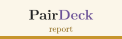</picture></a><a href="../pairtex/README.md"><picture><source media="(prefers-color-scheme: dark)" srcset="../docs/figures/tab-pairtex-off-dark.svg"></picture></a><a href="../pairtalk/README.md"><picture><source media="(prefers-color-scheme: dark)" srcset="../docs/figures/tab-pairtalk-off-dark.svg"></picture></a><a href="../pairposter/README.md"><picture><source media="(prefers-color-scheme: dark)" srcset="../docs/figures/tab-pairposter-off-dark.svg"></picture></a></p>
<!-- /TABBAR -->

<p align="center">
  <picture>
    <source media="(prefers-color-scheme: dark)" srcset="docs/figures/banner-dark.svg">
    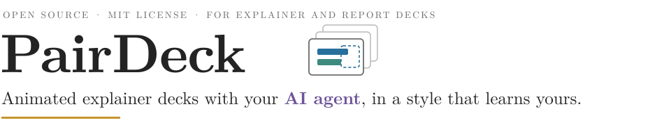
  </picture>
</p>

<p align="center">
  <a href="../LICENSE"></a>
  
  
  
</p>

You give your agent the material (a paper, a project, the results of an investigation) and it builds a short web deck that
explains it with pictures that build up step by step, checked slide by slide on screenshots. Then you drag a box over any
slide in the local review page and type what should change: the agent fixes the deck in the background and replies under your
comment, and every change you keep, rewrite or undo teaches it your visual style.

- **Interactive.** Drag a box on any slide in the local review page and type; your agent fixes the deck in the background and replies under your comment.
- **Adaptive.** Your visual style guide (palette, type, density, how a slide builds) grows from every change you keep, rewrite or undo, and can start from your past decks.

<p align="center">
  <picture>
    <source media="(prefers-color-scheme: dark)" srcset="docs/figures/loop-dark.svg">
    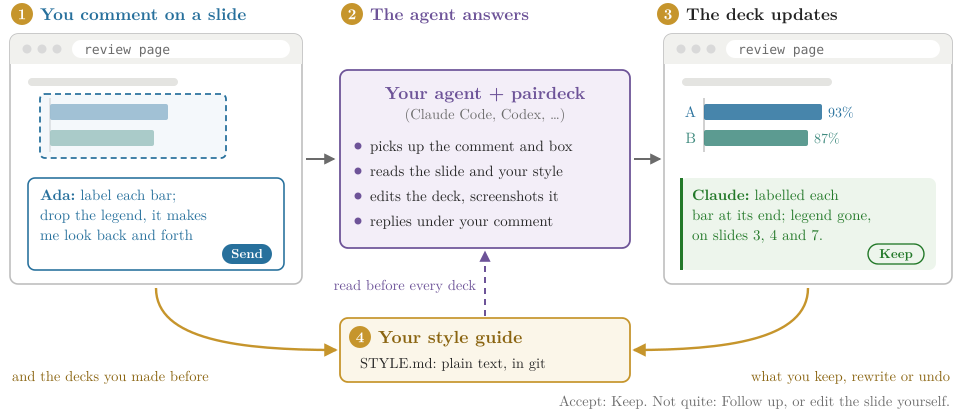
  </picture>
</p>

## Why not a chatbot, or a slide app?

<p align="center">
  <picture>
    <source media="(prefers-color-scheme: dark)" srcset="docs/figures/versus-dark.svg">
    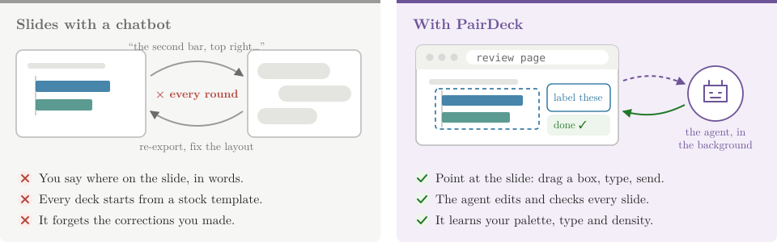
  </picture>
</p>

A slide app gives you a blank page and a template; a chatbot gives you a draft you cannot point at. PairDeck gives your agent
an engine built for explaining (colour-coded actors, diagrams and charts that build up, one real interaction, light and dark
mode, a phone layout), a checklist and a screenshot tool to hold it to, and a place for you to point.

## What a deck looks like

<p align="center">
  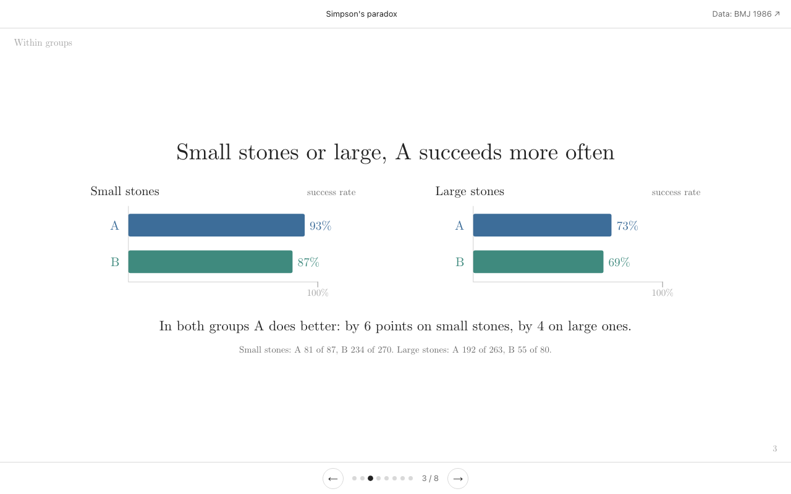
</p>
<p align="center">
  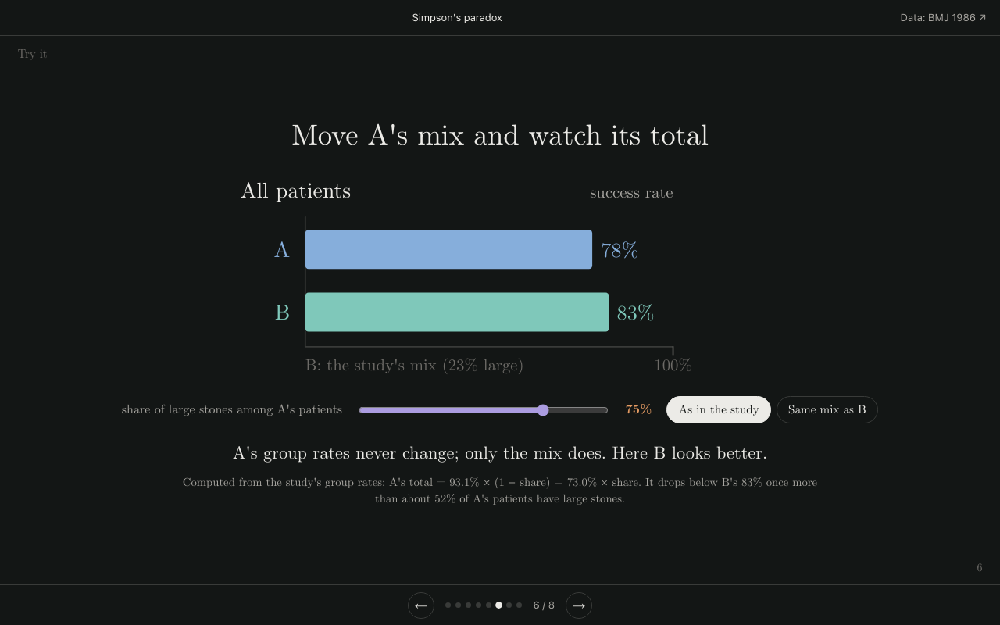
  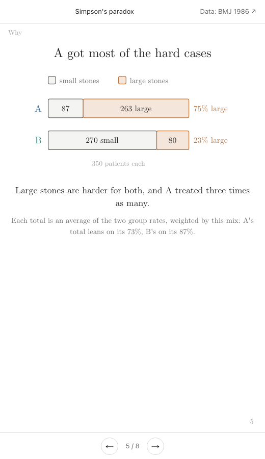
</p>

The example is [`examples/simpsons-paradox/`](examples/simpsons-paradox/index.html): eight slides on Simpson's paradox with
the data of a published kidney-stone study, built with `pairdeck new`, checked with `pairdeck qa`, with a slider on slide 6.
Open it with `pairdeck review` after setup (below), or serve this folder with `python3 -m http.server` and open
`examples/simpsons-paradox/`.

## Comment where you look

<p align="center">
  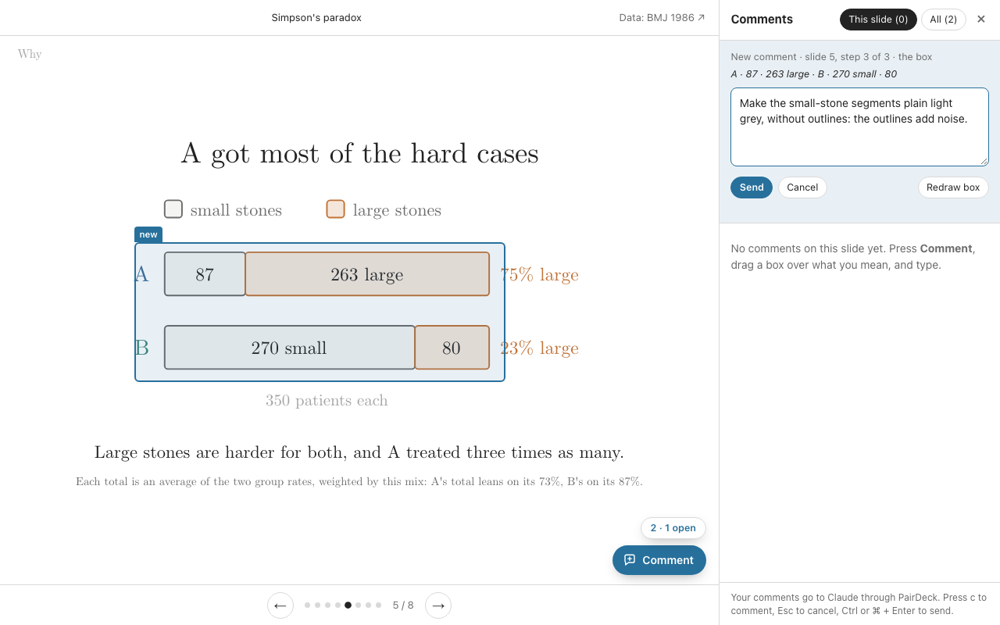
</p>

`pairdeck review` serves the deck on your own computer (127.0.0.1) with a comment layer on top; the deck file itself is
never changed. Press **Comment** (or `c`), drag a box over what you mean (a click means the whole slide), type, **Send**. The
comment records the slide, the build step, the box and the words under it, so the agent knows exactly what "this" is. The box
is pinned to the figure or text block under it, so it lands on the same marks in a narrower window or on a phone.

<p align="center">
  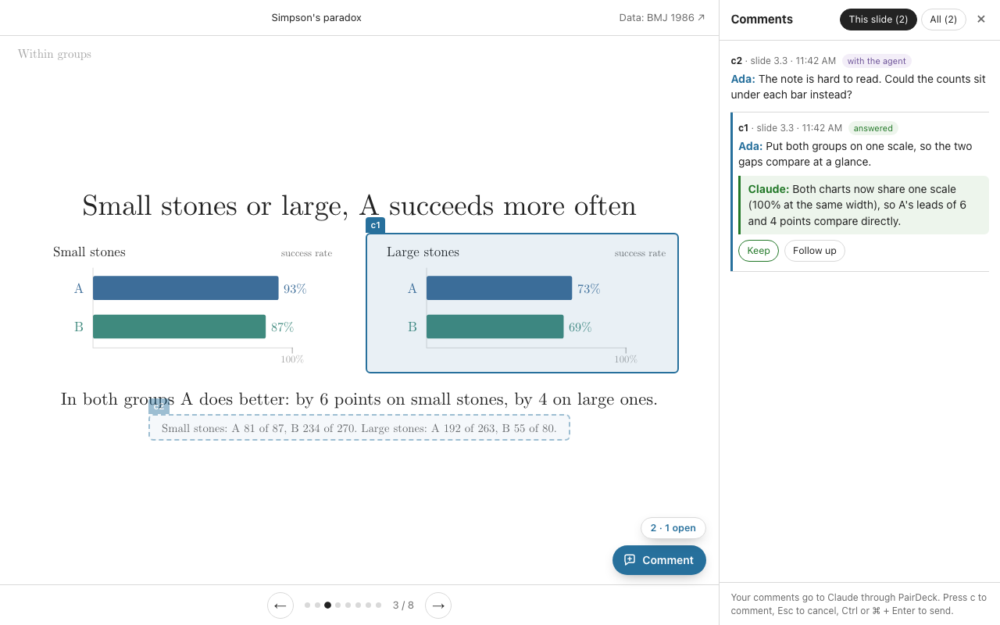
</p>

The agent's reply appears under your comment, in green, and the page reloads by itself when the deck changes on disk. Press
**Keep** to accept the change as made, **Follow up** to push back. You can also edit the deck's HTML yourself in any editor:
the watcher sees your edit and compares it with the agent's last version.

## A style guide that learns you

<p align="center">
  <picture>
    <source media="(prefers-color-scheme: dark)" srcset="docs/figures/style-dark.svg">
    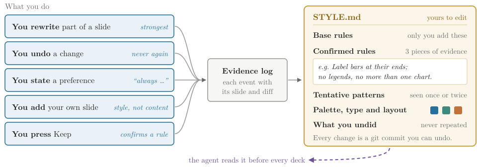
  </picture>
</p>

A pattern starts as tentative and is confirmed after three independent pieces of evidence, or at once when you say "always"
or "never". Concrete choices (which colour marks what, typefaces, how many words a slide) go into a table. Your edits to
`STYLE.md` win, and style never changes a number or a claim. One guide serves all your decks and every agent.

## Start from your own decks

<p align="center">
  <picture>
    <source media="(prefers-color-scheme: dark)" srcset="docs/figures/seed-dark.svg">
    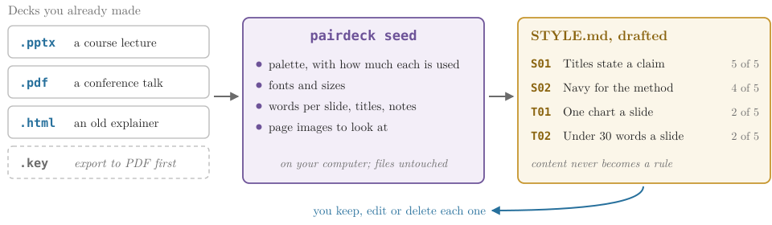
  </picture>
</p>

`pairdeck seed` reads decks you already made, so the first draft is already close. It runs on your computer, writes only into
your data home and never changes the files it reads. The agent then looks at the page images and the numbers, drafts entries
(a pattern in three or more of your decks may start as confirmed), and shows you the five to ten strongest to keep, edit or
delete.

## Use it with the agent you already have

PairDeck has no model and needs no API key of its own. It runs inside the coding agent you already use, on your own plan:
**Claude Code** (a Claude subscription or API key) or **Codex** (a ChatGPT plan or OpenAI API key), or any other agent that runs
shell commands. One install serves both; your style guide and decks live in `~/.pairdeck`, not in the agent.

**Let your agent install it.** Paste this into Claude Code or Codex:

```text
Install PairDeck from https://github.com/MarcusYF/pairlab and follow pairdeck/AGENTS.md
```

## Or start in three steps yourself

```sh
git clone https://github.com/MarcusYF/pairlab && cd pairlab && ./install.sh pairdeck   # 1. install
pairdeck setup --name "Ada Lovelace"                                              #    and say who you are
pairdeck seed ~/talks/ ~/exports/old-deck.pdf                                     # 2. optional: your past decks
```

3. In Claude Code or Codex, say **"make a visual explainer of this paper with pairdeck"** (or of a project, a concept, your
   findings). The agent builds and checks the deck, opens the review page, and on "watch the deck" answers each comment as it
   arrives. Other agents: [AGENTS.md](AGENTS.md).

The rest of this page is the reference.

## Install

Needs Python 3.9+, git, and Chrome or Chromium for screenshots (`CHROME=/path/to/chrome` if it is elsewhere). macOS and
Linux; on Windows, use WSL. Seeding renders PDF pages with macOS's PDFKit, or `pdftoppm` (poppler) or `mutool` (MuPDF) where
installed; PowerPoint files get page images only when LibreOffice (`soffice`) is installed.

```sh
git clone https://github.com/MarcusYF/pairlab && cd pairlab && ./install.sh pairdeck
pairdeck setup --name "Ada Lovelace"       # creates ~/.pairdeck (or --home DIR, or $PAIRDECK_HOME)
```

The **data home** holds your profile, your style vault and your decks' working state. It is a git repository (unless
`--no-git`), so every change to the style guide is a commit you can read or undo. It never goes into the code folder.

## Make a deck

The agent does this when you ask for an explainer; the commands are here for reference.

```sh
pairdeck new mydeck --title "Simpson's paradox" --subtitle "How can a treatment…?" --dir ~/decks/mydeck
pairdeck qa mydeck                 # lint, layout check, screenshots of every slide: light, dark, phone width
pairdeck snapshot mydeck           # the agent's version, which your later edits are compared with
```

`new` writes `index.html` with the engine copied to `_deck/` (or `--engine-url /decks/_deck/` for a site that hosts the engine
once) and registers the deck; on a folder that already holds a deck it only registers it. `qa` serves the deck locally, steps
through every build, and reports overlapping or clipped labels, arrows that end inside shapes, lines through labels,
low-contrast text, text that scrolls inside a box and slides taller than the window; the screenshots go to
`~/.pairdeck/projects/mydeck/qa/`.

## Review and the loop

```sh
pairdeck review mydeck             # http://127.0.0.1:<port>/…/index.html with the comment layer; keeps running
pairdeck watch mydeck              # waits for comments and your edits, prints one batch, exits
pairdeck resolve mydeck c3 "Labelled each bar; legend removed on slides 3, 4 and 7."
```

The agent runs `review` and `watch` in the background. `watch` waits until nothing has changed for 8 seconds (`--settle`), so
several comments arrive as one batch, prints the batch (each comment's slide, step, box, the words under it, and a diff of any
edit you made to the deck since the agent's snapshot) and exits; that exit wakes the agent. It holds a lock (one watcher per
deck; `--takeover` moves it), `--once` checks once, and it refuses to start (exit 4) when the agent answered comments and
changed the deck without a snapshot, so the agent's edits are never read as yours.

## Your visual style guide

`~/.pairdeck/vault/STYLE.md` is read before every deck and grows after every batch. The evidence behind it is in
`vault/evidence.jsonl`, one event per line:

| Kind | What happened |
| --- | --- |
| `revised` | You changed part of what the agent made (the watcher compares the deck with the agent's snapshot, slide by slide) |
| `reverted` | You put back the version from before the agent's last change |
| `stated` | A comment states a general preference ("always…", "never…", "from now on…"); the agent can mark others |
| `own_edit` | Your own new work in the deck, such as a slide you added |
| `seed` | One of your past decks, read by `pairdeck seed` |
| `kept` | You pressed **Keep** on an answer |

`pairdeck learn mydeck` shows the waiting evidence in full; the agent distils it into `STYLE.md` and runs `learn --ack`.
Evidence that is not yours (a test, a colleague's edit) is dropped with `learn --discard <ids> --why "…"`. Deck-specific points
(this deck's colour mapping, its terms) go into the deck's `NOTES.md` instead. The guide has the same skeleton as PairTeX's and
PairTalk's ([the style-vault contract](../docs/style-vault.md)); its domain table is **Palette, type and layout**.

## Seed

```sh
pairdeck seed ~/talks/ ~/exports/old.pdf --note "my last three conference decks"
pairdeck seed --list
pairdeck seed --forget seed-002    # removes the seed's folder and discards its events
```

Folders are searched recursively for `.pptx`, `.pdf` and `.html`; a `.key` file is listed as skipped (export it to PDF or PPTX
first). Each seed is a folder `vault/seed/<id>/` with `manifest.json` (files, SHA-256, pages), `stats.json` (palette with
shares, fonts and sizes, words per slide, titles, notes length, layouts), `samples.md` (titles, text and speaker notes per
slide) and `pages/` (up to 12 sampled page images per PDF). The reader is `../shared/seed_visual.py`, which PairTalk uses too.

## Deliver

```sh
pairdeck bundle mydeck             # dist/mydeck.html: one file with the engine, icons, images and fonts (about 0.6 MB)
pairdeck bundle mydeck --no-fonts  # under 0.1 MB; falls back to Latin Modern or Georgia
pairdeck card mydeck               # a 1200×630 share image from the title slide
```

The agent never publishes, deploys or sends a deck without your go-ahead.

## What goes where

- `pairdeck` itself sends nothing anywhere. The review page listens on 127.0.0.1 only and refuses requests from other sites.
- The agent reads your comments, the deck, your style guide and seeds, and sends them to its model provider, as any coding
  agent does with the files it works on.
- Your profile, style vault, comments and snapshots stay in your data home; your deck stays where you put it.

## Commands

| Command | What it does |
| --- | --- |
| `pairdeck setup --name … [--agent …] [--no-git]` | Your profile and data home |
| `pairdeck paths` / `pairdeck status [SLUG]` | Where everything is; a deck's snapshot, watcher, review page and comments |
| `pairdeck new SLUG --title … [--dir DIR]` | Scaffolds a deck with the engine and registers it (or registers an existing deck) |
| `pairdeck qa SLUG\|FILE [--slides …] [--steps] [--after JS --tag T]` | Lint, layout check and screenshots |
| `pairdeck bundle SLUG [-o FILE] [--no-fonts]` / `pairdeck card SLUG` | One self-contained file; a share image |
| `pairdeck seed PATHS… [--note …]` / `--list` / `--forget ID` | Reads your past decks into the style vault |
| `pairdeck snapshot SLUG [-m …]` | Records the agent's version of the deck |
| `pairdeck review SLUG [--port N] [--open]` | Serves the deck with the comment layer on 127.0.0.1 |
| `pairdeck watch SLUG [--once] [--settle S] [--takeover]` | Waits for comments and your edits, prints one batch, exits |
| `pairdeck resolve SLUG ID "reply" [--stated]` | Answers a comment; the reply shows on the review page |
| `pairdeck learn [SLUG\|--all] [--ack IDS] [--discard IDS --why …]` | Shows style evidence, or marks it learned or not yours |

Exit codes of `watch`: 0 a batch, 1 nothing (with `--once` or `--max-hours`), 2 the deck is missing, 4 unsnapshotted agent
edits, 5 another watcher holds the deck.

## Files

| Path | Purpose |
| --- | --- |
| `bin/pairdeck` | The command-line tool (Python 3.9+, standard library; Chrome for screenshots) |
| `skill/` | The agent skill: `SKILL.md`, `references/` (style, components, content, qa, targets, learning, seeding), `assets/engine/` (CSS, JS, icons, Computer Modern fonts under the SIL Open Font License) and `assets/template.html` |
| `review/` | The comment layer the review page adds (`overlay.js`, `overlay.css`) |
| `templates/` | Starting points for a new style guide, loop preferences and deck notes |
| `examples/simpsons-paradox/` | The example deck |
| `tests/test_e2e.py` | End-to-end test in a temporary home: `python3 tests/test_e2e.py` |
| `docs/figures/`, `docs/img/` | The figures on this page (`make_figures.py` draws them, light and dark) and the screenshots |
| `AGENTS.md`, `CHANGELOG.md` | For agents; what changed |
| `~/.pairdeck/` | Your data: `profile.json`, `vault/` (STYLE.md, evidence.jsonl, preferences.md, seed/), `projects/<slug>/` |

## License

MIT ([LICENSE](../LICENSE)). The Computer Modern Unicode fonts in `skill/assets/engine/fonts/` are under the SIL Open Font
License 1.1 (`OFL.txt` beside them). The example's data come from a published 1986 study of kidney-stone treatments (linked
in the deck).
