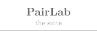
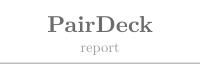
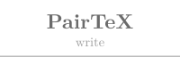
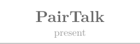
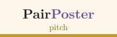
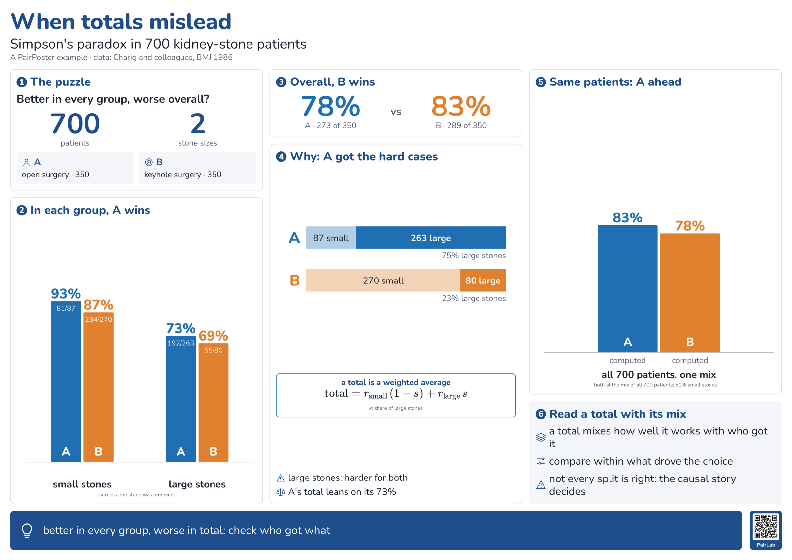

<!-- TABBAR -->
<p align="center"><a href="../README.md"><picture><source media="(prefers-color-scheme: dark)" srcset="../docs/figures/tab-overview-off-dark.svg"></picture></a><a href="../pairdeck/README.md"><picture><source media="(prefers-color-scheme: dark)" srcset="../docs/figures/tab-pairdeck-off-dark.svg"></picture></a><a href="../pairtex/README.md"><picture><source media="(prefers-color-scheme: dark)" srcset="../docs/figures/tab-pairtex-off-dark.svg"></picture></a><a href="../pairtalk/README.md"><picture><source media="(prefers-color-scheme: dark)" srcset="../docs/figures/tab-pairtalk-off-dark.svg"></picture></a><a href="../pairposter/README.md"><picture><source media="(prefers-color-scheme: dark)" srcset="../docs/figures/tab-pairposter-on-dark.svg"></picture></a></p>
<!-- /TABBAR -->

# PairPoster

**Conference posters with your AI agent, in a style that learns yours.** You give your agent the paper (or your LaTeX or
Beamer poster draft); it builds the poster as one web page at the venue's exact size, with icons, charts and schematics
instead of paragraphs, and checks it the way a poster session will read it: from two metres, in a few seconds. Then you zoom
in on the local review page, drag a box over anything and type what should change. The agent fixes the poster in the
background and replies under your comment, and every change you keep, rewrite or undo teaches it how you like posters.

- **Interactive.** Zoom in on the local review page, drag a box and type; your agent fixes the poster, checks it at print size and replies under your comment.
- **Adaptive.** Your poster-style guide (how few words, what goes where, how results are shown) grows from your comments and edits, and can start from your past posters.

<p align="center"></p>

A poster is an advertisement for the paper, not the paper. PairPoster is built around that: word budgets per block, phrases
instead of sentences, type that stays readable at print size, and a check that says so when a block is over budget.

## What it does

- **One page at print size.** The poster is HTML with physical units: the page is the venue's size in millimetres, type is in
  points. On screen it fits the window and zooms (+, −, 0 fits, 1 is print size); printed, it is exactly its size.
- **Pictures first.** An engine of blocks, icon chains, cards, big numbers, formula boxes (MathJax), icon rows and takeaway
  bands, 45 line icons, and inline SVG charts drawn from your numbers.
- **Checks that read like a poster session.** `pairposter qa` measures the laid-out poster in Chrome: anything that spills
  out of its box, type under the size floor at print scale, words per block and in all, sentences where a phrase would do,
  images under 150 dpi, blocks left half empty. It takes a picture of the whole poster and close-ups at readable size for the
  agent to look at.
- **Comment on the poster.** `pairposter review` serves it on 127.0.0.1 with a comment layer: zoom, drag a box, type. The
  comment records the block it points at and the words under the box; the reply shows under it, and the page reloads, at
  the same zoom, when the poster changes.
- **The loop.** `pairposter watch` wakes your agent with each batch of comments and your own edits; it fixes, answers,
  snapshots and learns, then watches again.
- **Charts from the paper's own data.** `tools/figdata.py` reads the lines and error bands back out of a matplotlib figure
  saved as a vector PDF, so a plot can be redrawn in the poster's style with readable labels.
- **Builds on screen.** Parts marked `data-build` appear step by step when the poster opens on a laptop or a tablet at the
  booth; print and the PNG always show the finished poster.
- **Print and upload.** `pairposter print` writes a one-page vector PDF at the venue's size (fonts embedded) and the PNG a
  venue's site asks for (by default within NeurIPS's 5120 × 2880 px and 10 MB).
- **A poster style guide that learns**, by PairLab's [style-vault contract](../docs/style-vault.md), seeded from your past
  posters if you like; the visual look (palette, typeface) is shared with your PairDeck guide.

## Start

```sh
git clone https://github.com/MarcusYF/pairlab && cd pairlab
./install.sh pairposter
pairposter setup --name "Ada Lovelace"
```

Then, in Claude Code or Codex: *"make a poster for this paper, 140 × 90 cm landscape"* or *"turn my Beamer poster into a
PairPoster and cut the words"*, and later *"watch my poster"*.

| Needs | Feedback lives in | Data home |
| --- | --- | --- |
| Python 3.9+, git, Chrome or Chromium; LaTeX only for vector QR codes | the local review page | `~/.pairposter` |

The example poster is in [`examples/simpsons-paradox/`](examples/simpsons-paradox/index.html) (open it in a browser; + and −
zoom, `p` plays the builds).

PairPoster runs on PairDeck's program (`../pairdeck/bin/pairdeck` in its poster flavour), so keep the PairLab folders together.

## Your data stays yours

The poster, its comments and your style guide stay on your computer; the review page listens on 127.0.0.1 only. Your agent
reads the files it works on and sends them to its model provider, as any coding agent does.

MIT. Nunito and the Computer Modern fonts are under the SIL Open Font License, MathJax under the Apache License 2.0.
