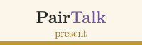
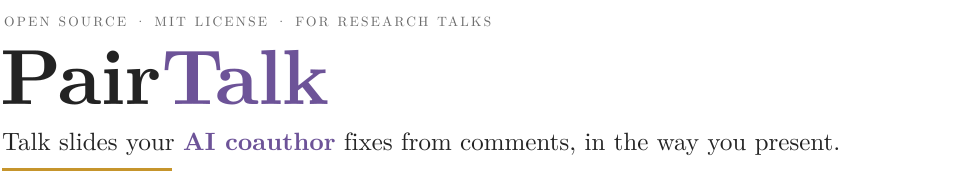
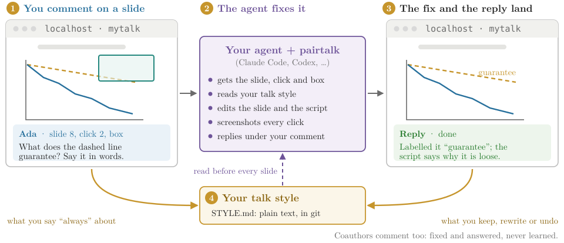
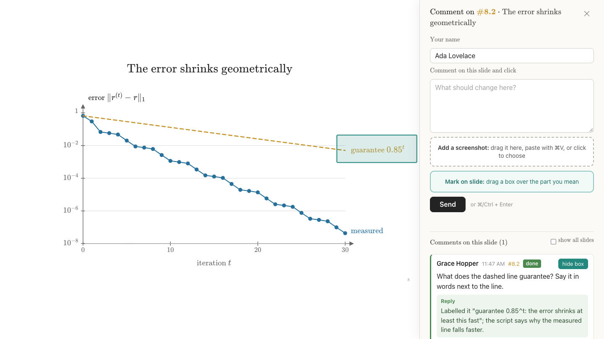
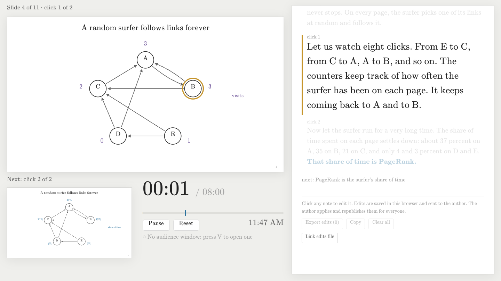
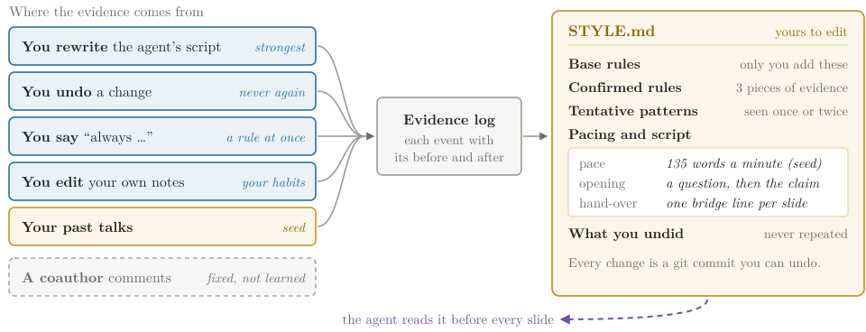
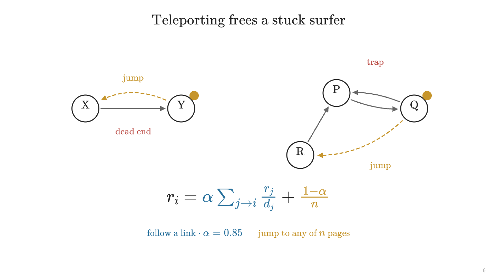

<!-- TABBAR -->
<p align="center"><a href="../README.md"><picture><source media="(prefers-color-scheme: dark)" srcset="../docs/figures/tab-overview-off-dark.svg"></picture></a><a href="../pairdeck/README.md"><picture><source media="(prefers-color-scheme: dark)" srcset="../docs/figures/tab-pairdeck-off-dark.svg"></picture></a><a href="../pairtex/README.md"><picture><source media="(prefers-color-scheme: dark)" srcset="../docs/figures/tab-pairtex-off-dark.svg"></picture></a><a href="../pairtalk/README.md"><picture><source media="(prefers-color-scheme: dark)" srcset="../docs/figures/tab-pairtalk-on-dark.svg"></picture></a></p>
<!-- /TABBAR -->

<p align="center">
  <picture>
    <source media="(prefers-color-scheme: dark)" srcset="docs/figures/banner-dark.svg">
    
  </picture>
</p>

<p align="center">
  <a href="../LICENSE"></a>
  
  
  
</p>

You comment on any slide and click of your talk, drawing a box around the part you mean, or you rewrite a line of the speaker
script. Your agent fixes the slide and the script in the background and replies under your comment, and every change you keep,
rewrite or undo teaches it how you build and give talks, so its first drafts need fewer comments over time.

PairTalk is built on [html-slide](https://github.com/Yanwei-Sun/html-slide) by Yanwei Sun: its slide engine, comment
panel and shared review site started there ([NOTICE.md](NOTICE.md)).

<p align="center">
  <picture>
    <source media="(prefers-color-scheme: dark)" srcset="docs/figures/loop-dark.svg">
    
  </picture>
</p>

## Comment where the talk lives

The talk opens in your browser. Press `c` on any slide and click: the comment knows the slide and the click it is about.
**Mark on slide** draws a box over the part you mean, and you can paste or drop up to four screenshots. Your agent receives
the comment with the slide's id, the click, the box in slide coordinates and the images, fixes the slide, checks every click
with screenshots, and answers. The reply appears under your comment.

<p align="center"></p>

`pairtalk serve` runs this on your computer, and nothing leaves it. For coauthors elsewhere, the same talk can go on your own
Cloudflare site, where anyone with the link and the passcode comments and edits the script
([the shared site](#the-shared-site-optional)). Coauthors' comments are fixed and answered like yours; only yours teach your
style.

## Rehearse with the speaker view and the script

Press `v` for the speaker view: the current slide, the next click, the note for this click in large type, and a timer against
your slot. The script lives in `SCRIPT.md`, one block per click: edit it in any editor, or click a note in the browser's
script panel (`s` `s`) and type. Your edits reach the agent like comments, and your rewrites of its lines are the strongest
evidence of how you speak.

<p align="center"></p>

## A talk-style guide that learns you

A chat window forgets what you corrected. PairTalk keeps what it learns about your talks, with the evidence, in a file you own.

<p align="center">
  <picture>
    <source media="(prefers-color-scheme: dark)" srcset="docs/figures/style-dark.svg">
    
  </picture>
</p>

A pattern starts as tentative and is confirmed after three independent pieces of evidence, or at once when you say "always" or
"never". Your edits to `STYLE.md` win, and style never changes a claim or a number. One guide serves all your talks, with
Claude Code or Codex. When you also use PairDeck, the agent takes your visual look (palette, type, layout) from PairDeck's
guide and keeps this one for how you build and give talks.

## Start from your past talks

```sh
pairtalk seed ~/talks/seminar.pptx --duration 45 --note "department seminar"
pairtalk seed ~/talks/workshop.pdf ~/talks/workshop-script.md --duration 20
```

`seed` reads slides (`.pptx` with speaker notes, `.pdf`, a PairTalk talk folder) and scripts (`SCRIPT.md`, `.md`, `.txt`):
page images, palette and words per slide through the suite's visual extractor, and from the notes the words per slide and per
minute and how each talk opens and closes. The agent turns that into first entries in your guide and shows you the strongest
ones to keep or delete. Everything stays in `~/.pairtalk` on your computer.

## Use it with the agent you already have

PairTalk has no model and needs no API key of its own. It runs inside the coding agent you already use, on your own plan:
**Claude Code** or **Codex**, or any other agent that runs shell commands. One install serves both; your talks and your style
guide live in `~/.pairtalk`, not in the agent.

**Let your agent install it.** Paste this into Claude Code or Codex:

```text
Install PairTalk from https://github.com/MarcusYF/pairlab and follow pairtalk/AGENTS.md
```

## Or start in three steps yourself

```sh
git clone https://github.com/MarcusYF/pairlab && cd pairlab && ./install.sh pairtalk   # 1. install
(cd pairtalk && npm install)                                                         #    the deck tools' packages
pairtalk setup --name "Ada Lovelace"                                                 #    and say who you are
pairtalk new mytalk --title "How PageRank ranks the web" --minutes 15                # 2. a talk folder
```

3. In Claude Code or Codex, say **"build mytalk from my paper"**, then **"watch mytalk"**. To try the loop first,
   `pairtalk new demo --example pagerank` makes the eight-minute demo talk shown on this page.

The rest of this page is the reference.

## Install

Needs Python 3.9+, git, Node 22+ and, for screenshots, an installed Chrome or Chromium. macOS and Linux; on Windows, use WSL.

```sh
git clone https://github.com/MarcusYF/pairlab && cd pairlab
./install.sh pairtalk          # links the skill for Claude Code and Codex, and ~/.local/bin/pairtalk
(cd pairtalk && npm install)   # once: acorn (reads the notes) and Playwright (screenshots with your Chrome; no browser download)
pairtalk setup --name "Ada Lovelace" --agent Claude
```

`pairtalk setup` creates your **data home**, `~/.pairtalk` (`--home DIR` to put it elsewhere, or `$PAIRTALK_HOME`): your
profile, your style vault and your talks' settings, as a git repository. It never goes into the code folder. The name matters:
comments and script edits under it are yours; others are coauthors'.

## A talk is a folder

`pairtalk new mytalk --title "…" [--minutes 15] [--dir DIR] [--example pagerank]` makes it (`./mytalk` by default):

| Path | What it is |
| --- | --- |
| `index.html` | The page: the title, the talk's name for comments (`window.DECK_COMMENTS`), the slot (`window.DECK_MINUTES`) |
| `slides/order.js` | The slide files in order; backup slides last |
| `slides/*.js` | One file per slide: its id, title, number of clicks, HTML and SVG, builds, and one speaker note per click |
| `SCRIPT.md` | The speaker script, one block per click, kept in step with the slides |
| `css/`, `js/`, `fonts/`, `vendor/` | The engine: a 1920 × 1080 stage that scales, builds, a speaker view, comments, the maths renderer (MathJax 3) |

Each slide reveals one idea per click (`data-in`, `data-out`, `data-dim` on any element, or numbers tweened by a `draw`
function). The demo talk, `examples/pagerank/`, has eleven slides and a backup: builds, a theorem, two charts drawn from
numbers it computes, and a script of about eight minutes.

<p align="center"></p>

## Review on your computer

`pairtalk serve mytalk` serves the talk at `http://127.0.0.1:8790` with the comment panel switched on; comments, screenshots
and script edits go to `~/.pairtalk/projects/mytalk/inbox/`. It answers only this computer.

| Action | Key |
| --- | --- |
| Next build, then next slide; previous | Click, `→`, Space; right-click, `←` |
| Comment on this slide and click | `c` |
| Speaker view in a second window | `v` |
| Script panel (click a note to edit it) | `s` `s` |
| Slide overview | `s` |
| Full screen, blank screen, menu | `f`, `b`, `m` |
| Jump to a slide | its number, then Enter |

`pairtalk bundle mytalk` writes one offline HTML file (`dist/mytalk.html` in the talk folder) to present without a network;
`pairtalk shots mytalk` screenshots every slide and click and reports console errors and missing fonts.

## The loop

In Claude Code or Codex: "watch mytalk". That session reads your style guide and the talk's notes and runs
`pairtalk watch mytalk` in the background. The watcher waits until feedback has settled, prints one batch and exits, which
wakes the agent:

1. the batch lists each comment (id, slide, click, author, text, box, attachments) and each script edit (before and after);
2. the agent fixes the slides, applies the script edits (`pairtalk script apply`), checks every changed click
   (`pairtalk shots`), and records what it made (`pairtalk snapshot`);
3. it answers each comment (`pairtalk resolve mytalk <id> "reply"`), learns from the evidence, and starts the watcher again.

**Several people.** Each comment and script edit carries the writer's name. Yours (your profile's name, or no name on the
review server on your computer) are yours; anyone else's are a coauthor's: fixed and answered, never evidence.

**Safety built in.** One watcher per talk (`--takeover` moves it). If the slides changed after a batch and no snapshot recorded
the agent's work, the watcher stops (exit 4) rather than mistake the agent's edits for yours. Script edits are applied only when
the note still reads what the editor saw; a conflict applies nothing.

## The shared site (optional)

Your own Cloudflare Pages site with a D1 database: a passcode gate, then the talk with the same comment panel and script
editing for anyone with the link. You create the project, the database and the passcode with your own account; PairTalk keeps
your ids in your data home, never in the code folder.

```sh
pairtalk remote mytalk --config ~/.pairtalk/wrangler.user.toml --pages-project your-pages-project
pairtalk publish mytalk --init-db          # bundle, stage in ~/.pairtalk, deploy with Wrangler
pairtalk watch mytalk --remote             # the loop reads the site's comments and script edits
pairtalk publish mytalk --dev              # or: the same site on http://127.0.0.1:8788, with a local database
```

Setup, step by step: [skill/references/cloudflare.md](skill/references/cloudflare.md). It needs `npm install wrangler@4` and
`wrangler login` once.

## Your talk style

`~/.pairtalk/vault/STYLE.md` is read before every slide and grows after every batch. The evidence behind it is in
`vault/evidence.jsonl`, one event per line, following the suite's [style-vault contract](../docs/style-vault.md):

| Kind | What happened |
| --- | --- |
| `revised` | You rewrote what the agent made: a note in `SCRIPT.md`, in the browser, or in a slide file, or a slide file itself |
| `reverted` | You restored what the agent had replaced |
| `stated` | Your comment states a general preference ("always", "never", "every time", "以后" …), or the agent recorded one with `resolve --stated` |
| `own_edit` | You changed text the agent did not write (a template line, your own note, a coauthor's wording) |
| `seed` | One past talk given to `pairtalk seed` |

`pairtalk learn mytalk` shows what is waiting; the agent distils it into the guide and marks it `--ack`; `--discard <ids>
--why "…"` keeps an event out for good. Talk-specific points (terms, numbers, venue) go to the talk's
`~/.pairtalk/projects/mytalk/NOTES.md` instead. Built-in rules (pacing, one idea per click, titles as claims, what stays off a
slide) are in [skill/references/playbook.md](skill/references/playbook.md); your guide overrides them.

## Commands

The agent runs these; they are here for reference. `pairtalk <command> -h` lists every option.

| Command | What it does |
| --- | --- |
| `pairtalk setup --name … [--agent …]` | Your profile and data home |
| `pairtalk paths`, `pairtalk status [talk]` | Where everything is; your talks, or one talk's inbox, watcher and evidence |
| `pairtalk new <talk> --title … [--dir] [--minutes] [--example]` | A talk folder from the template, registered in the data home |
| `pairtalk serve <talk>` | The talk on this computer, with comments and script editing |
| `pairtalk watch <talk> [--remote] [--once]` | Waits for settled feedback, prints one batch, exits; a lock per talk, `--takeover` |
| `pairtalk resolve <talk> <id> "reply" [--remote] [--stated …]` | Answers one comment |
| `pairtalk snapshot <talk>` | Records the talk as the agent made it, and brings SCRIPT.md up to date |
| `pairtalk script export\|apply <talk>` | SCRIPT.md from the slides; or SCRIPT.md's and the browser's edits into the slides |
| `pairtalk shots <talk> [--ids] [--click] [--box]` | Screenshots of every click, with a manifest of errors |
| `pairtalk bundle <talk>` | One offline HTML file |
| `pairtalk learn <talk>\|--all [--ack …] [--discard … --why …]` | Talk-style evidence waiting to be learned |
| `pairtalk seed <files…> [--duration] [--note] [--list] [--forget ID]` | Learn from your past talks |
| `pairtalk remote <talk> …`, `pairtalk publish <talk> [--dev] [--stage]` | The optional shared site |

## What goes where

- `pairtalk` reads your talk folder and your data home. `serve` answers only `127.0.0.1`. With the shared site, it talks to
  your Cloudflare account through Wrangler, and nothing else.
- The agent reads the comment, the slide, your style guide and the talk's notes, and sends them to its model provider, as any
  coding agent does with the files it works on.
- Your profile, style vault, comments, screenshots and evidence stay in `~/.pairtalk`; the talk stays in its folder.

## Files

| Path | Purpose |
| --- | --- |
| `bin/pairtalk` | The command-line tool (Python 3.9+, standard library) |
| `template/` | The engine and three starter slides that `pairtalk new` copies |
| `examples/pagerank/` | The demo talk: slides, `talk.json` |
| `tools/` | Node tools: notes and SCRIPT.md (`script.mjs`), screenshots (`slide_shots.mjs`), the offline bundle (`bundle.mjs`) |
| `cloudflare/` | The shared site's middleware, D1 schema, a generic Wrangler config, and its offline test |
| `skill/` | The agent skill, linked at `~/.claude/skills/pairtalk` and `~/.agents/skills/pairtalk` by the installer |
| `templates/` | Starting points for the style guide, loop preferences and a talk's notes |
| `tests/test_e2e.py` | End-to-end test with a temporary home: `python3 tests/test_e2e.py` |
| `docs/` | The figures (`make_figures.py`) and screenshots (`make_screens.mjs`) on this page |
| `AGENTS.md`, `CHANGELOG.md` | For agents; what changed |

## Limits

- The deck is HTML: there is no PowerPoint or Keynote export. Present from the browser or the bundled file; print with
  `?print` (each slide's last click) or `?print=steps`.
- `seed` reads speaker notes from `.pptx`, PairTalk folders and script files; a PDF gives only its look. Keynote files need an
  export to PDF or PPTX first.
- The browser's maths renderer bundles the fonts for ordinary formulas; very tall delimiters and bold maths need fonts it does
  not ship, and `pairtalk shots` reports them.
- On the shared site, names in the comment panel are what people type; everyone with the passcode has the same access.

## Acknowledgments

PairTalk grew out of [html-slide](https://github.com/Yanwei-Sun/html-slide) by **Yanwei Sun**: an HTML slide template for
research talks with animated builds, a speaker script, and coauthor comments that a coding agent can act on. The slide engine,
the comment panel and marked boxes, the presenter controls, the screenshot, script and bundle tools and the Cloudflare review
site all started from his code, and the idea of handing slide-level feedback straight to an agent is his. Thank you, Yanwei.
The files derived from html-slide keep its notice; [NOTICE.md](NOTICE.md) lists them.

## License

MIT ([LICENSE](../LICENSE)), except the code derived from html-slide, which is shared under html-slide's own permissive notice
([NOTICE.md](NOTICE.md)). The bundled maths renderer is MathJax (Apache 2.0, `template/vendor/mathjax/LICENSE`); its fonts
are under the SIL Open Font License 1.1 (`template/fonts/OFL.txt`).
